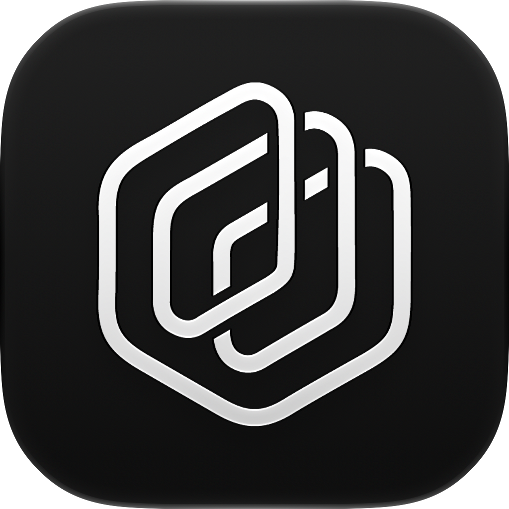
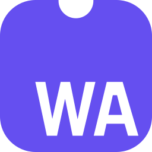
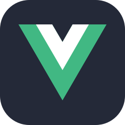
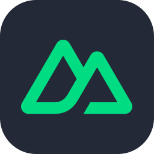
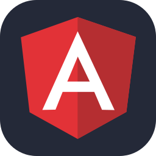
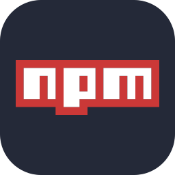
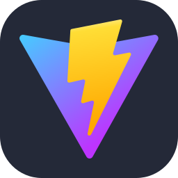
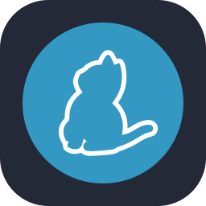

<p align="center">
  <a href="https://browserpod.io">BrowserPod.io</a>
  &nbsp;•&nbsp;
  <a href="https://browserpod.io/docs">Docs</a>
  &nbsp;•&nbsp;
  <a href="https://browsercode.io">BrowserCode</a>
  &nbsp;•&nbsp;
  <a href="https://discord.leaningtech.com">Discord</a>
</p>

<h3 align="center">
  
  <br>
  BrowserPod
  <br>
  The microVM that runs in the browser
</h3>

<p align="center">
  <a href="https://discord.leaningtech.com"></a>
  <a href="https://github.com/leaningtech/browserpod-meta/issues"></a>
  <a href="https://npm.im/@leaningtech/browserpod"></a>
</p>

<p align="center">
  <b>Built with:</b>&nbsp;&nbsp;
  
</p>

<p align="center">
  <b>Runtimes:</b>&nbsp;&nbsp;
  
  &nbsp;&nbsp;
  
  &nbsp;&nbsp;
  
  &nbsp;&nbsp;
  
</p>

<p align="center">
  <b>Supported frameworks:</b>&nbsp;&nbsp;
  
  &nbsp;&nbsp;
  
  &nbsp;&nbsp;
  
  &nbsp;&nbsp;
  
  &nbsp;&nbsp;
  
  &nbsp;&nbsp;
  
  &nbsp;&nbsp;
  
</p>

<p align="center">
  <b>Supported tools:</b>&nbsp;&nbsp;
  
  &nbsp;&nbsp;
  
  &nbsp;&nbsp;
  
  &nbsp;&nbsp;
  
  &nbsp;&nbsp;
  
  &nbsp;&nbsp;
  
</p>

## What is BrowserPod?

BrowserPod is a microVM that runs in the browser. It sits between a virtual machine and a microVM: it boots a Linux-like kernel near-instantly, with a small footprint and on-demand loading. Node.js, Rust, git, bash and npm run on the user's own device, with zero latency, so compute costs you zero.

**New in BrowserPod 4.0:** BrowserPod is free, with no account or API key. When a pod needs the internet (a public URL, npm, GitHub), **BrowserPod Edge** connects it.

Developers use BrowserPod to **sandbox untrusted and AI-generated code** in the browser, build web applications that **embed server-side processes client-side**, **create interactive documentation and playgrounds** and **run AI coding CLIs in-browser** without modification (e.g., Claude Code, Codex).
<br>

## Features
| Feature | Description |
| --- | --- |
| **WebAssembly** | BrowserPod compiles full native runtimes to WebAssembly, running them directly in the browser without a server. |
| **Kernel** | BrowserPod's in-browser kernel exposes a Linux-compatible syscall interface rather than a limited JavaScript shim. |
| **Sandbox** | BrowserPod runs directly in the browser, inheriting its security boundary. |
| **Local execution** | Code runs on the user's device: zero latency between an agent and its code, and no compute cost to you. |
| **Runtimes** | In-browser runtimes for Node.js 22 and Rust. Python is in preview, Go is coming soon and Ruby will follow. |
| **Compatibility** | The Node.js runtime ships with npm built in, and supports most frameworks and tools (including React, Angular, Next.js, Express.js and Vite), with Wasm overrides for native dependencies (see [Native binaries](#native-binaries)). Most Rust CLI tools work unmodified, including jj, ripgrep and Codex. |
| **Filesystem** | A block-based streaming virtual filesystem provides full POSIX compatibility. Disk images are streamed on demand, and any file changes stay local to the browser session using either IndexedDB or the Origin Private File System (OPFS). |
| **Portals** | Ports that open in BrowserPod can be shared via a temporary private URL. This secure URL routes external traffic directly to the service running in the browser, enabling live previews and collaboration without any backend servers. Portals are part of [BrowserPod Edge](#add-browserpod-edge). |
| **Tools** | BrowserPod provides a wide range of developer tools and frameworks, including bash, git and ripgrep, plus npm for Node.js. |
| **Multithreading** | Web workers enable true multithreading for complex, multi-process workloads that would normally require a full operating system. |
| **Terminal** | To connect a process's I/O, pass it a `Terminal`, an in-browser pseudo-terminal handle created via `createDefaultTerminal` or `createCustomTerminal`. BrowserPod uses xterm.js by default, but also supports other Wasm-compatible pseudo-terminals (e.g., ghosttyweb). |
| **Networking** | Without a key, a pod reaches the network through the page's `fetch()`: HTTP, HTTPS and WebSocket to origins that allow CORS (`BrowserPod.opinionatedFetch` adds the npm registry). [BrowserPod Edge](#add-browserpod-edge) adds Portals, TCP and outbound access without CORS limits, under an allowlist. Custom allowlists come with Edge Pro. |

<br>

## Getting started

### Quickstart

```
npm create browserpod-quickstart
```

Pick a template:

| Template | What it runs |
|---|---|
| `vite-basic` | Node.js REPL |
| `bash` | Bash terminal |
| `vite-web` | Express server with a live preview (uses Portals) |

No API key is needed. To enable [Portals](https://browserpod.io/docs/understanding-browserpod/portals), which let you preview and share services running inside your pod, create a free BrowserPod Edge key at [console.browserpod.io](https://console.browserpod.io) and paste it after choosing a template. You can also add `VITE_BP_APIKEY` to the project's `.env` later.

### npm

```
npm install @leaningtech/browserpod
```

### yarn

```
yarn add @leaningtech/browserpod
```

### Boot a pod

No account or API key needed:

```js
import { BrowserPod } from "@leaningtech/browserpod";

const pod = await BrowserPod.boot({
  network: await BrowserPod.createFetchNetwork({ fetch: BrowserPod.opinionatedFetch }),
});
const terminal = await pod.createDefaultTerminal(document.querySelector("#console"));
await pod.run("bash", [], { terminal });
```

The page must be [cross-origin isolated](#cross-origin-isolation).

### Add BrowserPod Edge

When a pod needs Portals, TCP, or outbound access without CORS limits, boot it on an Edge network with a key from [console.browserpod.io](https://console.browserpod.io):

```js
const pod = await BrowserPod.boot({
  network: await BrowserPod.createEdgeNetwork({ apiKey }),
});
pod.onPortal(({ url, port }) => console.log(`Port ${port} is live at ${url}`));
```

Edge has a free monthly allowance; see [pricing](https://browserpod.io/pricing).

- **[Read our detailed getting started guide](https://browserpod.io/docs/getting-started/quickstart)**

## Runtimes

BrowserPod supports Node.js and Rust, with Python in preview. Go is coming soon; Ruby will follow.

| Runtime  | Availability | Since |
| ------------- | :------------- | :------------- |
| Node.js | Live 🟢 | browserpod-1.0 |
| Rust | Live 🟢 | browserpod-3.0 |
| Python | Preview 🟠 | — |
| Go | Coming soon 🟠 | — |
| Ruby | Planned ⚪ | — |

## Considerations

### Browser

Chromium-based browsers (Chrome, Edge) give the best results. Firefox and Safari work with some limitations, and memory-heavy workloads may fail in Safari.

### Native binaries

BrowserPod runs Node.js in a Wasm environment. Packages that ship native binaries for specific CPU architectures will not run unless they provide a Wasm build.

Many popular build tools publish an official Wasm version alongside the native one. You can tell your package manager to install the Wasm version instead, anywhere in your dependency tree, without changing your own code.

#### Common Wasm overrides

| Native package | Replace with | What it does |
| --- | --- | --- |
| `esbuild` | `npm:esbuild-wasm@*` | Bundler used by Vite and many dev servers |
| `rollup` | `npm:@rollup/wasm-node@*` | Bundler used by Vite for production builds |
| `@parcel/watcher` | `npm:@parcel/watcher-wasm@*` | Watches files for changes during development |

Add them under `overrides` in your `package.json`:

```json
{
  "overrides": {
    "esbuild": "npm:esbuild-wasm@*",
    "rollup": "npm:@rollup/wasm-node@*",
    "@parcel/watcher": "npm:@parcel/watcher-wasm@*"
  }
}
```

If you use Yarn, the field is called `resolutions` instead of `overrides`. The contents are the same.

#### Framework-specific packages

Some frameworks ship their Wasm build as a separate package that you add as a normal dependency, rather than as an override:

| Package | Needed for |
| --- | --- |
| `@next/swc-wasm-nodejs` | Wasm build of the SWC compiler used by Next.js |
| `@oxc-minify/binding-wasm32-wasi` | Minifier for Nuxt and other Oxc-based toolchains |
| `@oxc-parser/binding-wasm32-wasi` | Parser for Nuxt and other Oxc-based toolchains |
| `@oxc-transform/binding-wasm32-wasi` | Transformer for Nuxt and other Oxc-based toolchains |

### Cross-origin isolation

BrowserPod uses `SharedArrayBuffer`, which means it can only run on cross-origin isolated pages.

To enable **cross-origin isolation**, your page must send both of these headers:

```
Cross-Origin-Opener-Policy: same-origin
Cross-Origin-Embedder-Policy: require-corp
```

- **[Learn more about cross-origin isolation](https://browserpod.io/docs/understanding-browserpod/cross-origin-isolation)**

## Resources

- **[Documentation](https://browserpod.io/docs)**: Complete guides, tutorials, and API reference
- **[BrowserCode](https://browsercode.io)**: Try BrowserPod in your browser, with nothing to install
- **For coding agents**: [`AGENTS.md`](AGENTS.md), the [BrowserPod skill](https://browserpod.io/skills/browserpod/SKILL.md) and [the docs as Markdown](https://browserpod.io/docs/llms.txt)
- **[Showcase](https://browserpod.io/showcase/)**: Community projects built on BrowserPod
- **[Discord Community](https://discord.leaningtech.com)**: Get help and share your projects
- **[GitHub Issues](https://github.com/leaningtech/browserpod-meta/issues)**: Report bugs and request features
- **[Yarn 6 playground](https://v6.yarnpkg.com/playground)**: Yarn 6 runs on BrowserPod in its official playground. 

<br>

## Licensing

BrowserPod is proprietary software. It's free to use for personal and open-source projects.

Commercial support, feature fast-tracking, sponsored development and consulting packages are available for Enterprise customers.

Generous token grants are available for start-ups and open-source projects.

See our [pricing](https://browserpod.io/browserpod-pricing-policy) for more details or [contact us](https://browserpod.io/contact/) if you've got questions.
